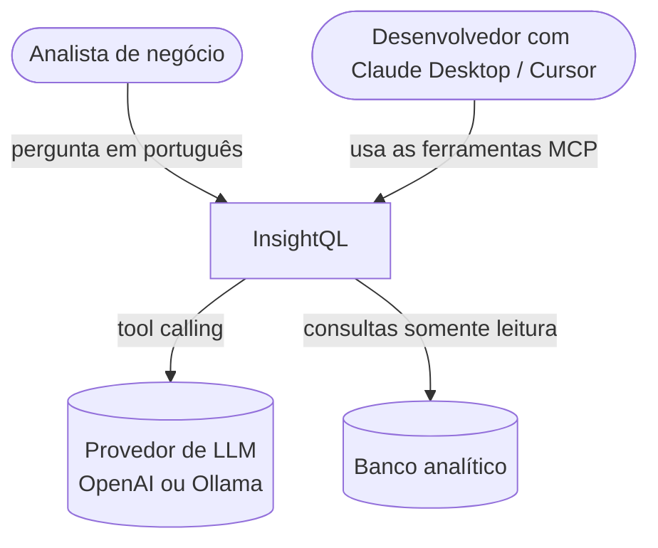
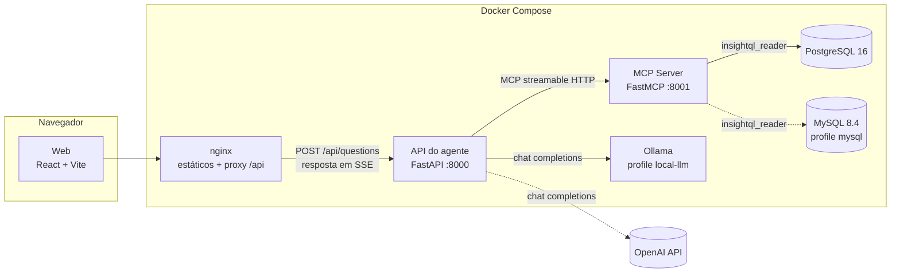
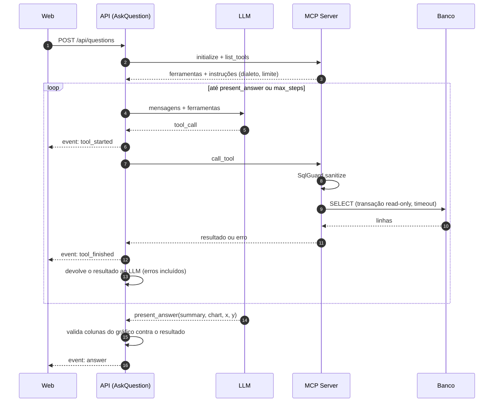
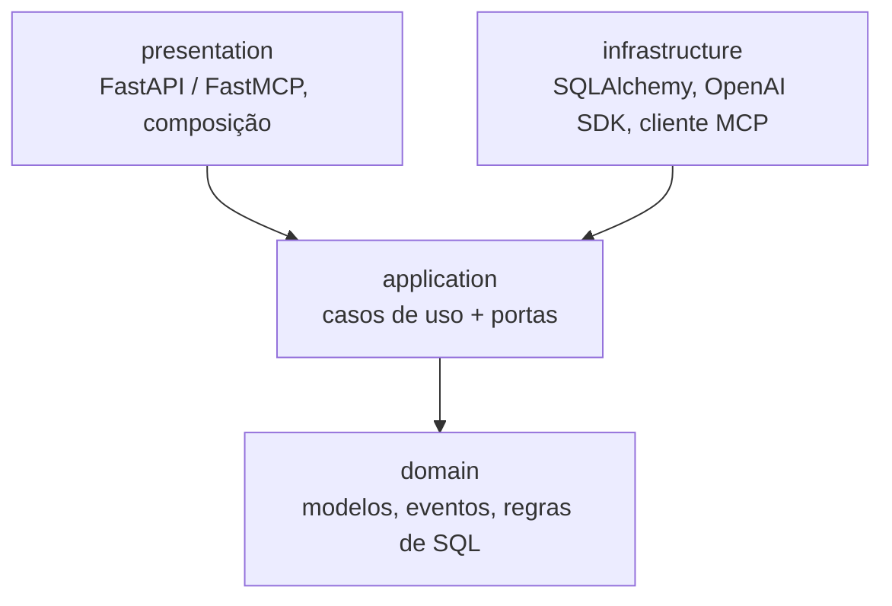

# 02 - Arquitetura

## Contexto (C4 nível 1)

## Containers (C4 nível 2)

| Container | Responsabilidade | Não faz |
|---|---|---|
| **web** | Captura a pergunta, mostra o raciocínio em tempo real e renderiza gráfico, SQL e tabela | Não conhece MCP nem LLM |
| **api** | Orquestra o loop do agente, converte ferramentas MCP em *function calling*, escolhe a visualização e transmite eventos | Não acessa o banco |
| **mcp-server** | Expõe `list_tables`, `describe_table` e `run_query`; valida e executa SQL | Não conhece LLM |
| **postgres / mysql** | Dados e usuário somente leitura | — |

## Fluxo de uma pergunta

Pontos importantes do fluxo:

- **Passo 3:** as instruções do servidor MCP (dialeto e limite de linhas) entram no *system prompt*. Assim o agente se adapta a PostgreSQL ou MySQL sem mudar código.
- **Passo 10:** quando o banco rejeita a consulta, o erro volta ao modelo como resultado da ferramenta. É isso que permite a autocorreção.
- **`present_answer`:** é uma ferramenta local da API, não do MCP. Ela força o modelo a terminar com uma saída estruturada em vez de texto livre.
- **Validação do gráfico:** se o modelo sugerir uma coluna que não existe no resultado, a API cai para tabela. O front nunca recebe um gráfico quebrado.

## Camadas (Clean Architecture)

Os dois serviços Python seguem a mesma organização. A regra de dependência aponta sempre para dentro.

### mcp-server

| Camada | Arquivos | Papel |
|---|---|---|
| domain | `models.py`, `errors.py`, `sql_guard.py` | Entidades de catálogo e resultado; política de consulta |
| application | `ports.py`, `service.py` | Portas `SchemaCatalog` e `QueryExecutor`; `InsightService` aplica o guard antes de executar |
| infrastructure | `database.py` | Implementa as duas portas com SQLAlchemy e normaliza o resultado com pandas |
| presentation | `server.py` | Registra as ferramentas no FastMCP e roda o I/O bloqueante em thread |

### api

| Camada | Arquivos | Papel |
|---|---|---|
| domain | `conversation.py`, `events.py` | Mensagens, tool calls e eventos do agente, independentes de fornecedor |
| application | `ports.py`, `ask_question.py` | Portas `LanguageModel` e `ToolGateway`; loop do agente |
| infrastructure | `openai_model.py`, `mcp_gateway.py` | Adaptadores para a API compatível com OpenAI e para o cliente MCP |
| presentation | `app.py`, `container.py` | HTTP + SSE e composição das dependências |

O caso de uso `AskQuestion` não importa nada de OpenAI nem de MCP. Nos testes, ele roda com um `ScriptedModel` e um `FakeGateway`. Trocar o provedor de LLM, ou trocar MCP por chamadas diretas, é escrever um adaptador novo.

## Segurança: defesa em profundidade

| Camada | Controle | Protege contra |
|---|---|---|
| 1. Parser (`SqlGuard`) | Uma instrução, só `SELECT`/`WITH`/`UNION`, sem nós de escrita | Prompt injection pedindo `DELETE`, `DROP` etc. |
| 1. Parser | Bloqueio de `information_schema`, `pg_catalog`, `pg_*` | Enumeração de usuários e metadados do servidor |
| 1. Parser | Bloqueio de `pg_sleep`, `pg_read_file`, `version()` e afins | DoS e leitura de arquivos |
| 1. Parser | `LIMIT` imposto ou reduzido | Respostas gigantes |
| 2. Conexão | `SET TRANSACTION READ ONLY` + timeout por sessão | Falha do parser |
| 3. Banco | Usuário `insightql_reader` só com `SELECT` e `default_transaction_read_only` | Falha da aplicação inteira |

O teste `test_database_user_cannot_write_even_without_guard` executa um `DELETE` direto no adaptador, pulando o guard, e verifica que o banco recusa.

## Decisões

| ADR | Decisão |
|---|---|
| [0001](adr/0001-mcp-como-fronteira-de-dados.md) | MCP como fronteira entre o agente e os dados |
| [0002](adr/0002-defesa-em-profundidade-sql.md) | Defesa em profundidade para SQL gerado por LLM |
| [0003](adr/0003-provedor-llm-compativel-openai.md) | Adaptador único para APIs compatíveis com OpenAI |
| [0004](adr/0004-sse-para-streaming.md) | SSE para transmitir o raciocínio do agente |
| [0005](adr/0005-tudo-via-docker.md) | Docker como única dependência de desenvolvimento e CI |
