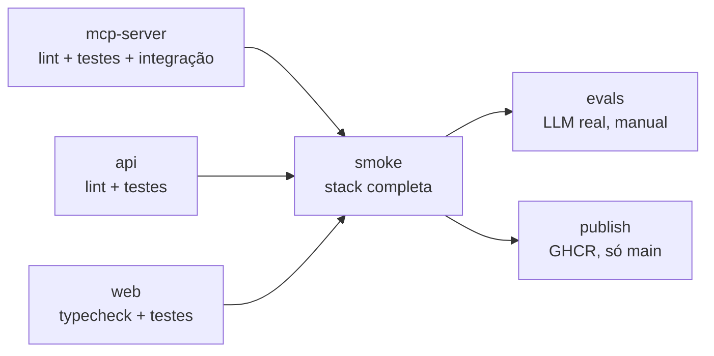

# 04 - Pipeline de CI/CD

Este guia explica a pipeline do projeto do zero: o que cada parte faz, como configurar no GitHub e como reproduzir tudo localmente.

Arquivo: [`.github/workflows/ci.yml`](../.github/workflows/ci.yml)

## Conceitos em 1 minuto

| Termo | O que é |
|---|---|
| **Workflow** | Um arquivo YAML em `.github/workflows/`. O GitHub executa automaticamente quando um evento acontece. |
| **Evento (`on`)** | O que dispara o workflow: push, pull request, execução manual. |
| **Job** | Um conjunto de passos que roda numa máquina virtual limpa. Jobs rodam em paralelo por padrão. |
| **Step** | Um comando (`run`) ou uma action pronta (`uses`). |
| **`needs`** | Faz um job esperar outros terminarem com sucesso. |
| **Secret** | Valor sensível (chave de API) guardado no GitHub, que nunca aparece no log. |
| **Variable** | Valor de configuração não sensível (nome do modelo, URL). |

## Princípio: o CI usa os mesmos comandos que você

Nenhum job instala Python ou Node. Todos chamam `docker compose`, exatamente como no seu terminal. Isso traz três vantagens:

- **Se passa na sua máquina, passa no CI.** As versões estão fixadas nas imagens.
- **O workflow fica simples:** não há `setup-python`, `setup-node` nem cache de dependências manual.
- **Trocar de plataforma de CI** (Azure DevOps, GitLab) é copiar os mesmos comandos.

## Gatilhos

```yaml
on:
  push:
    branches: [main]
  pull_request:
  workflow_dispatch:
    inputs:
      run_evals:
        type: boolean
```

| Evento | Quando acontece | O que roda |
|---|---|---|
| `pull_request` | Ao abrir ou atualizar um PR | Testes e smoke test |
| `push` na `main` | Após o merge | Testes, smoke test e publicação das imagens |
| `workflow_dispatch` | Botão **Run workflow** na aba Actions | Testes e smoke test; evals se `run_evals` for marcado |

`concurrency` cancela execuções antigas da mesma branch quando chega um push novo, para economizar minutos.

## Fluxo dos jobs



### 1. `mcp-server`, `api` e `web` (em paralelo)

```bash
docker compose --profile test run --rm --build mcp-test
```

- `--profile test` habilita os serviços de teste, que ficam desligados no `up` normal.
- `--build` constrói o *stage* `test` do Dockerfile, que roda lint (ruff), checagem de formatação e testes.
- No `mcp-test`, o compose sobe o PostgreSQL antes (por causa do `depends_on`), e os testes de integração rodam contra um banco de verdade.
- `--no-deps` na API e no front evita subir o banco, que esses testes não usam.
- O último passo usa `if: always()` para limpar containers e volumes mesmo quando um teste falha.

### 2. `smoke`

Sobe a stack inteira com `docker compose up -d --build --wait`. O `--wait` só retorna quando os *healthchecks* passam. Depois disso, o job verifica:

1. O nginx serve o front.
2. O proxy `/health` chega até a API.
3. A API consegue abrir sessão MCP com o servidor, as três ferramentas existem e um `DELETE` é bloqueado.

Esse job pega o tipo de erro que testes unitários não pegam: uma porta errada no compose, uma variável de ambiente faltando, uma incompatibilidade de versão do protocolo MCP entre cliente e servidor.

Em caso de falha, o passo `docker compose logs` imprime o log de todos os containers.

### 3. `evals` (manual)

Roda o agente contra um LLM real e falha se a acurácia ficar abaixo do mínimo. Ele é manual porque:

- custa dinheiro (chamadas de API);
- respostas de LLM variam, então não convém bloquear todo PR por isso.

Rode antes de mudar o prompt, o modelo ou as descrições do schema.

### 4. `publish` (só na `main`)

Constrói a imagem `runtime` de cada serviço (via `matrix`) e publica no GitHub Container Registry:

```
ghcr.io/guilhermesilva97/insightsql/mcp-server:latest
ghcr.io/guilhermesilva97/insightsql/mcp-server:<sha-do-commit>
```

- A tag com o SHA permite fazer deploy ou rollback de uma versão exata.
- `cache-from`/`cache-to: type=gha` reaproveita camadas entre execuções.
- O nome passa por `${GITHUB_REPOSITORY,,}` porque o registry exige letras minúsculas.

## Configurando no GitHub, passo a passo

### 1. Subir o repositório

```bash
git init
git add .
git commit -m "feat: estrutura inicial do InsightQL"
git branch -M main
git remote add origin https://github.com/guilhermesilva97/insightsql.git
git push -u origin main
```

O primeiro push já dispara o workflow. Acompanhe na aba **Actions**.

### 2. Permitir a publicação de pacotes

**Settings → Actions → General → Workflow permissions**: deixe **Read repository contents and packages permissions**. O próprio workflow pede `packages: write` só no job `publish`, seguindo o princípio do menor privilégio.

Depois da primeira publicação, as imagens aparecem em **Packages** no seu perfil. Para que qualquer pessoa consiga baixar, abra o pacote e mude **Package settings → Change visibility → Public**.

### 3. Configurar os evals (opcional)

**Settings → Secrets and variables → Actions**

| Tipo | Nome | Exemplo |
|---|---|---|
| Secret | `LLM_API_KEY` | `sk-...` |
| Variable | `LLM_BASE_URL` | `https://api.openai.com/v1` (padrão se vazio) |
| Variable | `LLM_MODEL` | `gpt-4o-mini` (padrão se vazio) |

Para rodar: **Actions → CI → Run workflow →** marque **Rodar evals com LLM real**.

### 4. Proteger a branch `main`

**Settings → Branches → Add branch ruleset** (ou *Branch protection rule*):

- Require a pull request before merging.
- Require status checks to pass, selecionando:
  - `MCP server (lint + testes + integração)`
  - `API do agente (lint + testes)`
  - `Front-end (typecheck + testes)`
  - `Smoke test da stack completa`

A partir daí, nada entra na `main` sem passar pela pipeline.

### 5. Badge no README

O README já aponta para:

```
https://github.com/guilhermesilva97/insightsql/actions/workflows/ci.yml/badge.svg
```

Em um fork, troque `guilhermesilva97` pelo seu usuário do GitHub.

## Reproduzindo localmente

| Job | Comando |
|---|---|
| mcp-server | `docker compose --profile test run --rm --build mcp-test` |
| api | `docker compose --profile test run --rm --build --no-deps api-test` |
| web | `docker compose --profile test run --rm --build --no-deps web-test` |
| smoke | `docker compose up -d --build --wait` e depois abrir http://localhost:8080 |
| evals | `docker compose --profile evals run --rm --build evals` |
| limpar tudo | `docker compose --profile test --profile evals down -v` |

Para validar o YAML do workflow antes do push:

```bash
docker run --rm -v "$(pwd):/repo" -w /repo rhysd/actionlint:latest .github/workflows/ci.yml
```

## Problemas comuns

| Sintoma | Causa provável | Solução |
|---|---|---|
| `ruff format --check` falha | Código fora do padrão de formatação | `docker run --rm -v "$(pwd)/api:/app" -w /app insightql-api-test ruff format src tests evals` (troque `api` por `mcp-server` se for o caso) |
| `npm ci` falha no build do front | `package-lock.json` desatualizado | Regerar com `docker run --rm -v "$(pwd)/web:/app" -w /app node:22-alpine npm install --package-lock-only` |
| `publish` falha com `denied` | Permissão de pacotes | Revisar o passo 2 da configuração |
| Evals falham com `Configure o secret` | Secret ausente | Revisar o passo 3 |
| Smoke falha no `--wait` | Container não fica saudável | Ver a saída do passo de logs; geralmente é variável de ambiente ou porta |

## Como estender

- **Deploy automático:** adicionar um job `deploy` com `needs: [publish]` que atualize um Azure App Service ou um AWS ECS com a tag `${{ github.sha }}`.
- **Análise de segurança:** adicionar `aquasecurity/trivy-action` para escanear as imagens antes de publicar.
- **Azure DevOps:** os mesmos comandos `docker compose` funcionam como steps `script:` num `azure-pipelines.yml`.
